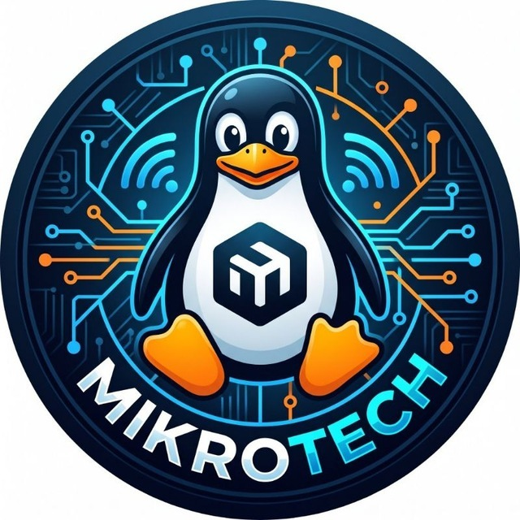

<div align="center">
  

  <h1>MikroTech</h1>
  <p><strong>Belajar MikroTik, langkah demi langkah.</strong></p>
  <p>Ruang belajar modern untuk memahami jaringan dan menguasai konfigurasi MikroTik.</p>

  <p>
    <a href="https://nodejs.org/"></a>
    <a href="https://expressjs.com/"></a>
    <a href="https://www.mysql.com/"></a>
  </p>

  <p>
    <a href="#-mulai-cepat">Mulai cepat</a> ·
    <a href="#-fitur-unggulan">Fitur</a> ·
    <a href="#-teknologi">Teknologi</a> ·
    <a href="#-kontribusi">Kontribusi</a>
  </p>
</div>

---

## Tentang MikroTech

**MikroTech** adalah webapp edukasi MikroTik yang menyajikan panduan konfigurasi jaringan dengan cara yang terstruktur dan mudah diikuti. Pembaca dapat menjelajahi artikel berdasarkan kategori, sementara admin mengelola konten melalui panel yang praktis.

> **Fokus:** materi yang jelas, konfigurasi yang mudah dibaca, dan pengalaman belajar yang nyaman di desktop maupun ponsel.

## ✨ Fitur unggulan

### Untuk pembaca

- Beranda dengan pencarian, kategori, dan artikel terbaru.
- Artikel dengan URL yang mudah dibaca, gambar pendukung, dan konten Markdown.
- Penelusuran berdasarkan kategori serta halaman FAQ, Kontak, dan Tentang.
- Tampilan responsif dengan identitas visual MikroTech.

### Untuk admin

- Panel admin dengan autentikasi dan pengelolaan sesi berbasis MySQL.
- Buat, edit, hapus, simpan sebagai draf, dan terbitkan artikel.
- Kelola kategori, profil admin, dan pengaturan situs.
- Pratinjau artikel sebelum disimpan dan kotak masuk untuk pesan pembaca.

### Dibangun dengan perhatian pada keamanan

- Kata sandi admin disimpan sebagai hash.
- Perlindungan CSRF, Helmet, dan pembatasan percobaan login.
- HTML mentah tidak diaktifkan dalam konten Markdown.
- Kredensial lokal disimpan di `.env`, bukan di repositori.

## 🧰 Teknologi

| Area | Teknologi |
|---|---|
| Runtime | Node.js 20+ |
| Server dan routing | Express 5 |
| Template | EJS |
| Database | MySQL |
| Session | Express Session dan MySQL session store |
| Keamanan | Helmet, bcryptjs, CSRF, dan rate limiting |
| Konten artikel | Markdown-it |

## 🚀 Mulai cepat

### Persyaratan

- Node.js versi 20 atau lebih baru dan npm.
- MySQL yang aktif, misalnya melalui XAMPP.

### 1. Pasang dependensi

```bash
npm ci
```

### 2. Siapkan konfigurasi

Salin `.env.example` menjadi `.env`, lalu sesuaikan koneksi MySQL dan isi `SESSION_SECRET` dengan nilai acak minimal 32 karakter.

PowerShell:

```powershell
Copy-Item .env.example .env
```

macOS / Linux:

```bash
cp .env.example .env
```

### 3. Siapkan database

Jalankan MySQL, lalu impor [`db/schema.sql`](./db/schema.sql) melalui phpMyAdmin atau MySQL CLI. Skrip ini membuat database `mikrotech`, tabel aplikasi, pengaturan awal, dan kategori bawaan.

### 4. Buat akun admin

Isi `ADMIN_USERNAME` dan `ADMIN_PASSWORD` di lingkungan terminal, lalu jalankan skrip pembuatan akun. Username harus 3–80 karakter dan kata sandi minimal 6 karakter.

PowerShell:

```powershell
$env:ADMIN_USERNAME = "admin"
$env:ADMIN_PASSWORD = "ganti-dengan-kata-sandi-aman"
npm run create-admin
```

macOS / Linux:

```bash
ADMIN_USERNAME=admin ADMIN_PASSWORD='ganti-dengan-kata-sandi-aman' npm run create-admin
```

### 5. Jalankan aplikasi

```bash
npm run dev
```

Buka **[http://localhost:3000](http://localhost:3000)**. Panel admin tersedia di **[http://localhost:3000/admin/login](http://localhost:3000/admin/login)**.

Untuk menjalankan tanpa mode watch, gunakan `npm start`.

## ⚙️ Konfigurasi lingkungan

| Variabel | Fungsi | Nilai contoh |
|---|---|---|
| `NODE_ENV` | Mode aplikasi | `development` |
| `PORT` | Port server | `3000` |
| `SESSION_SECRET` | Rahasia sesi, minimal 32 karakter | Buat nilai acak sendiri |
| `DB_HOST` | Host MySQL | `127.0.0.1` |
| `DB_PORT` | Port MySQL | `3306` |
| `DB_NAME` | Nama database | `mikrotech` |
| `DB_USER` | Pengguna MySQL | `root` |
| `DB_PASSWORD` | Kata sandi MySQL | Sesuai konfigurasi lokal |

`ADMIN_USERNAME` dan `ADMIN_PASSWORD` hanya diperlukan saat menjalankan `npm run create-admin`. Jangan gunakan kredensial contoh untuk deployment dan jangan unggah file `.env`.

## 🗂️ Struktur proyek

```text
MikroTech/
├── db/                 # Skema database
├── public/             # CSS, JavaScript, dan aset publik
├── scripts/            # Utilitas pembuatan admin
├── src/
│   ├── middleware/     # Autentikasi dan perlindungan CSRF
│   ├── routes/         # Route publik dan admin
│   └── utils/          # Markdown dan slug
├── tests/              # Pengujian otomatis
└── views/              # Template halaman EJS
```

## 🧪 Pengujian

Jalankan seluruh tes dengan:

```bash
npm test
```

## 🛣️ Cakupan dan pengembangan berikutnya

MikroTech saat ini berfokus pada pengalaman membaca, publikasi artikel, dan pengelolaan dasar oleh admin. Fitur seperti bookmark, komentar, statistik pembaca, sitemap, dan mode gelap dapat dikembangkan pada tahap berikutnya.

Sebelum deployment, siapkan konfigurasi produksi secara terpisah: rahasia sesi yang kuat, database yang diamankan, HTTPS, serta proses backup dan pemeliharaan.

## 🤝 Kontribusi

Ide, laporan bug, dan kontribusi sangat disambut. Silakan buat **Issue** untuk mendiskusikan perubahan besar sebelum membuka **Pull Request**.

## 📄 Lisensi

Belum ada lisensi open-source yang ditetapkan untuk repositori ini.

---

<div align="center">
  Dibuat untuk para pembelajar jaringan. <strong>Selamat bereksperimen!</strong>
</div>
